# LACES Storefront Redesign
### Progress update for the LACES team · November 2026

> **In one line:** we rebuilt the LACES shopping experience around the thing that makes LACES different — every purchase funds athletes — while keeping the logo, colours, photography and every existing store feature exactly as they are.

---

## 1. What we did before designing

| Step | What it involved | What we learned |
| --- | --- | --- |
| **Audit of getlaces.co** | Walked every page: home, menus, collections, product pages, cart, search, and the mobile site | The homepage was five similar product carousels; the Athlete Fund story only appeared near the very bottom; product names like "Snapback - Bay Area Downside Up - Blue/Gold" were hard to scan |
| **Brand deep-dive** | Read the Athlete Fund, NIL, Cal Athletes, Collaborations, Hat Fit Guide and Women Know Ball pages | Gave us verified facts to build on: 5% of every sale → Athlete Fund, split equally among athletes each month, free shipping over $50, 30-day returns |
| **Reference research** | Studied New Era, Kith, Goorin Bros, '47 and Aimé Leon Dore | Borrowed patterns (campaign heroes, bold collection headers, collabs told as stories, fit-focused filters) — not looks |
| **Photo library review** | Catalogued the 40+ lifestyle and product photos already in the store | Every image in the new design is a real LACES photo; no stock imagery |

**Direction chosen: "Athlete-First Editorial."** Clean, product-forward pages in the existing LACES black/white/grey, bold condensed headlines, real athlete photography, and the Athlete Fund woven through the whole journey — hero, homepage, product page, cart, footer.

---

## 2. What changed, page by page

### Homepage — fully redesigned

| Before | After |
| --- | --- |
| 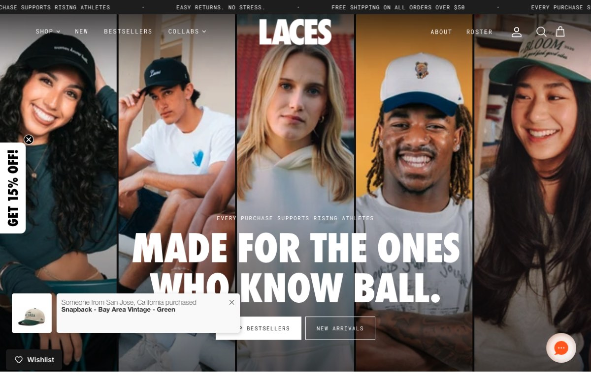 | 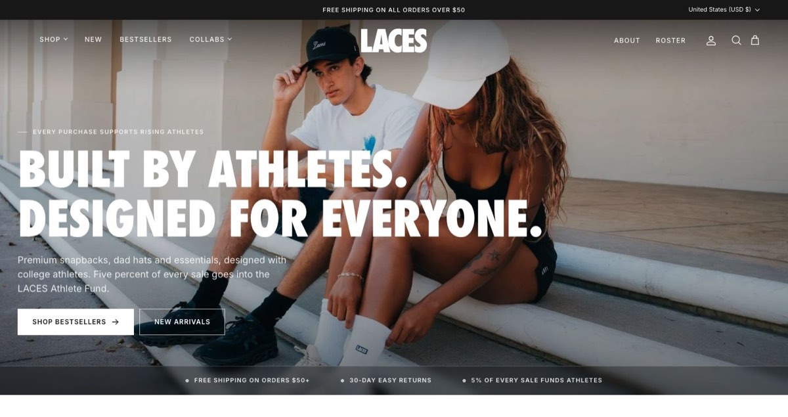 |

New flow, top to bottom:

1. **Hero** — one strong campaign photo, "Built by athletes. Designed for everyone.", and a proof strip: free shipping $50+ · 30-day returns · 5% of every sale funds athletes
2. **Shop by category** — Snapbacks, Dad Hats, Hoodies, Rep Your Team, Rep Your City, each showing how many styles are available
3. **The rotation** — Bestsellers / New arrivals / Signature in one block with tabs
4. **The Athlete Fund** — a dedicated story block explaining, in LACES' own words, how the Fund works
5. **Collaborations as stories** — Cal Athletes, Women Know Ball, Voices, Bloom, Bay Area Host Committee
6. **Snapback or Dad Hat?** — side-by-side fit guide
7. **Rep where you're from** — Team / City / Bay Area / Vintage tabs
8. **Women Know Ball** campaign banner with a shoppable product card
9. **Community** — real athlete photos, the Roster, @laces.athletes
10. Customer reviews and press logos (existing content, refreshed)

| Category tiles | Athlete Fund story |
| --- | --- |
| 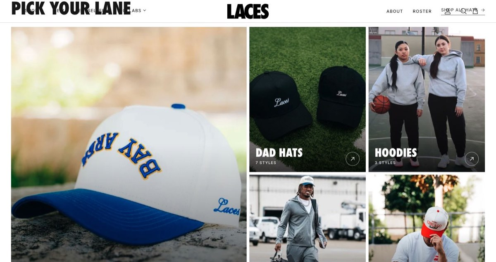 | 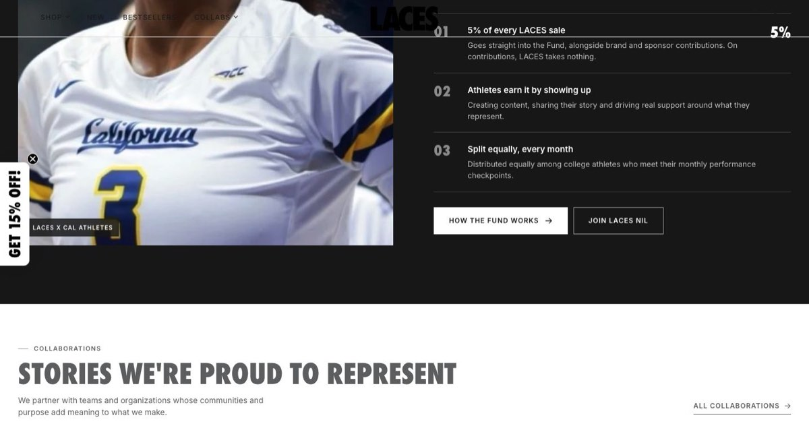 |

| Collaborations | Fit guide |
| --- | --- |
| 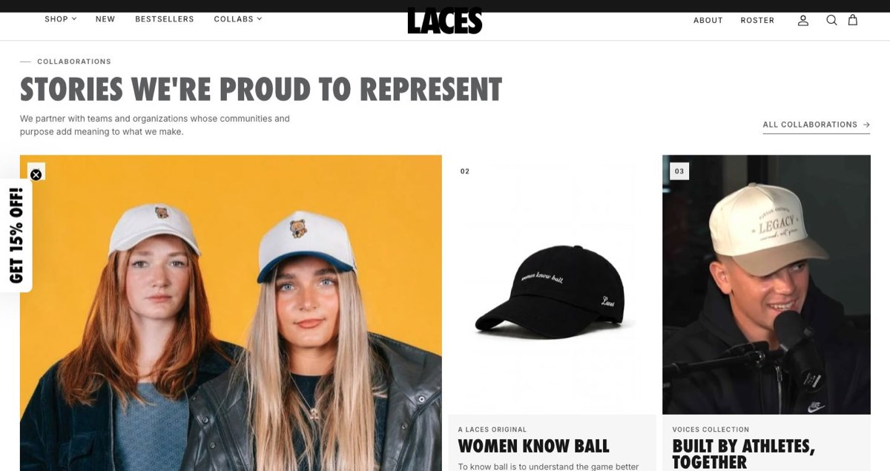 | 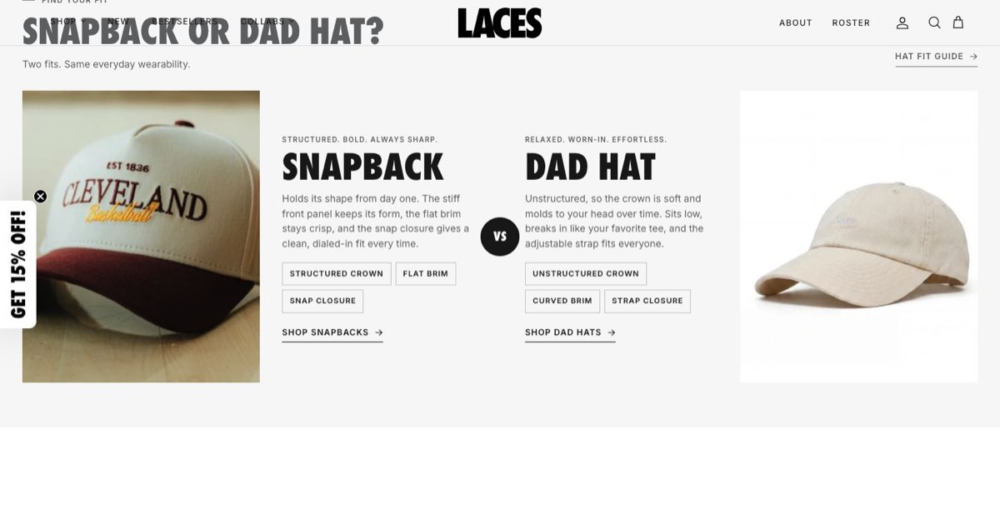 |

### Collection pages

| Before | After |
| --- | --- |
| 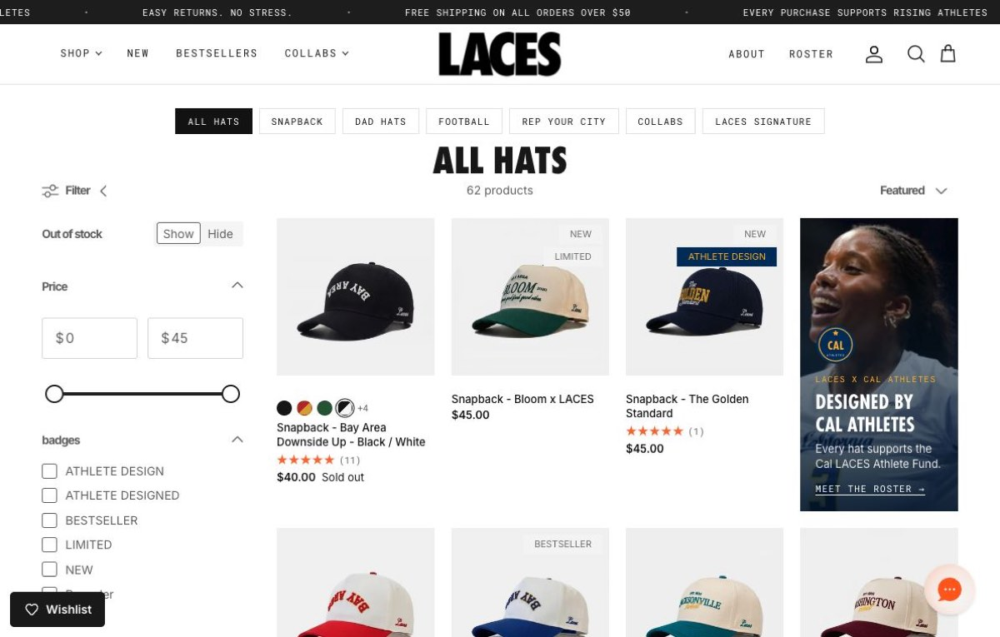 | 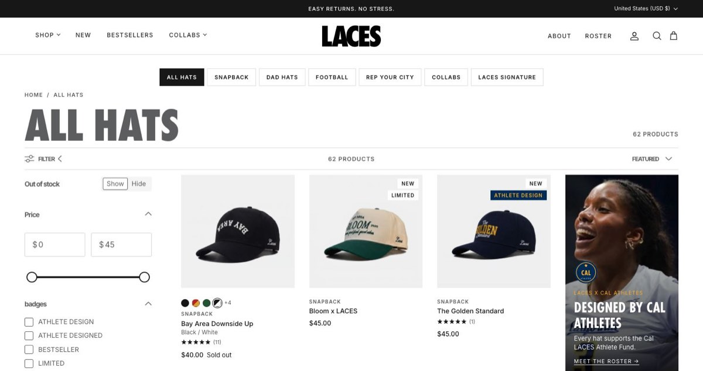 |

- Bold page header with breadcrumb, live product count and description
- Cleaner filters and sort bar
- Clearer product cards: fit, name and colour on separate lines, consistent labels, colour swatches, quick-buy on hover

### Product pages

| Before | After |
| --- | --- |
| 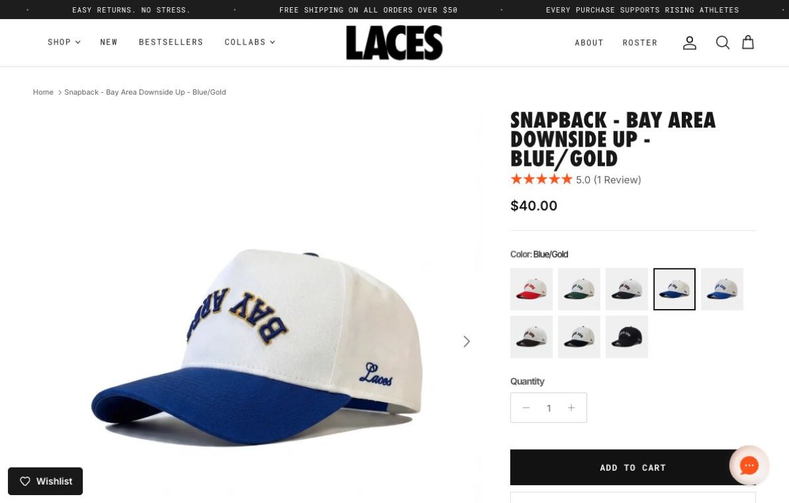 | 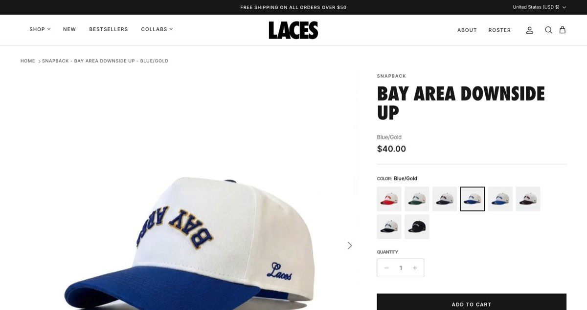 |

- Title split into fit / name / colourway so it reads at a glance
- Tidier buy area (colour tiles, quantity, Add to Cart, stock status, trust row)
- A short "5% of every LACES sale goes into the Athlete Fund" note beside Add to Cart
- Sticky Add to Cart, wishlist, reviews and payment buttons all kept

### Cart, search, navigation

| Cart drawer | Search |
| --- | --- |
| 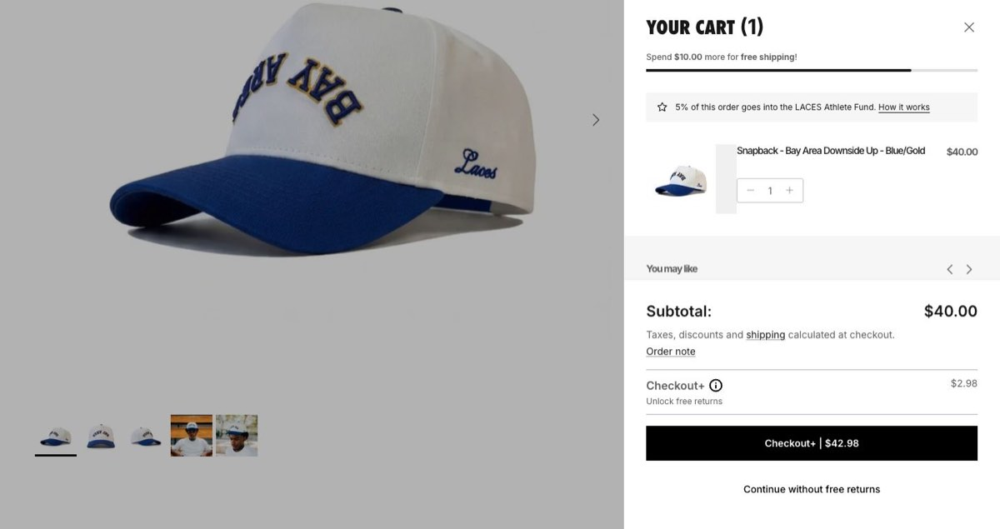 | 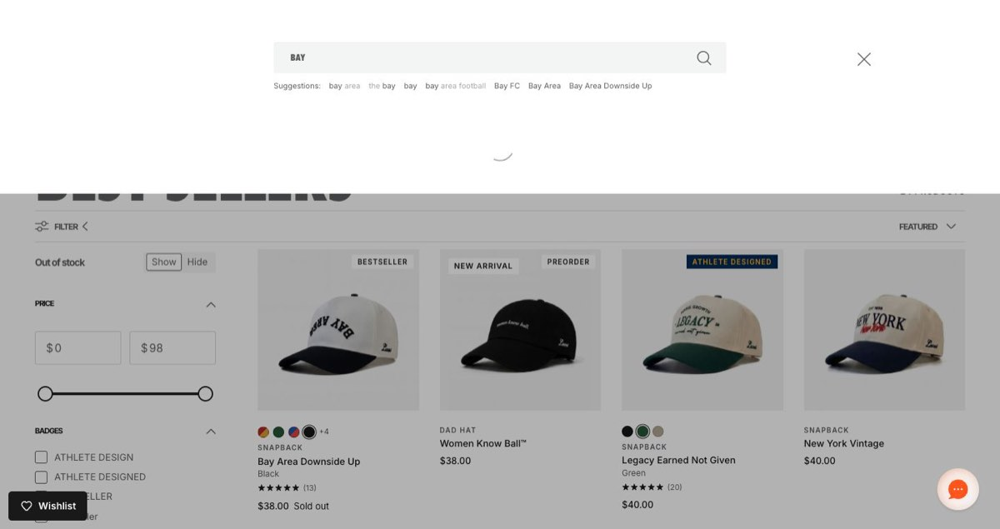 |

- Cart drawer refreshed, with the Athlete Fund note under the free-shipping bar; Loop "Checkout+" and cross-sells untouched
- Search overlay restyled with the same product cards
- Header and mega menu cleaned up; mobile menu now also carries the Athlete Fund message and quick links

### Footer — rebuilt

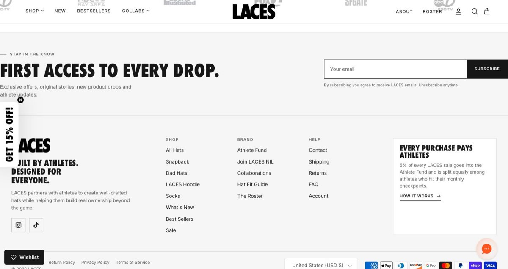

Newsletter band, brand statement, full Shop / Brand / Help links (Athlete Fund, NIL, Collaborations, Fit Guide, Roster, Contact, policies), Athlete Fund card, payment icons and region selector.

### Mobile

| Hero | Categories | Product page |
| --- | --- | --- |
| 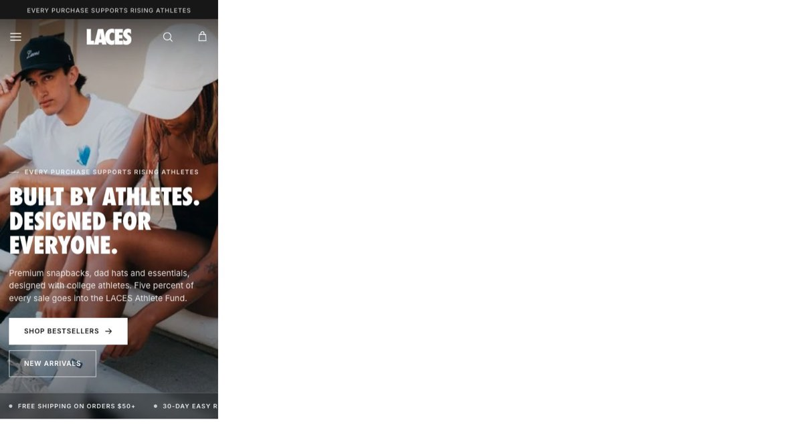 | 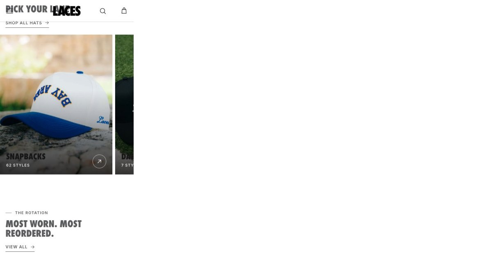 | 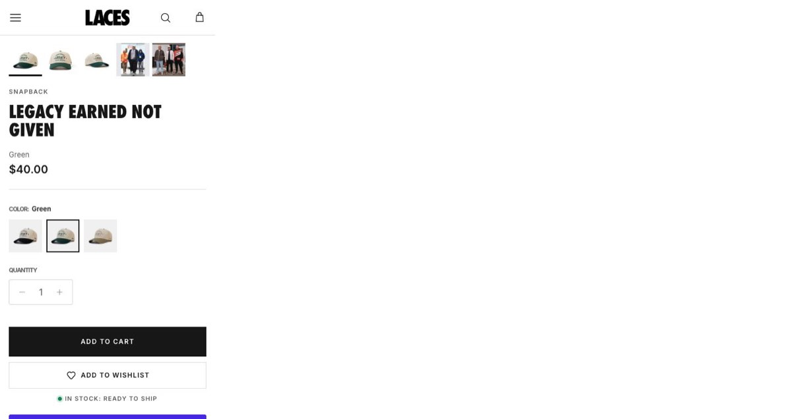 |

Designed mobile-first: swipeable category and product rails, a portrait hero crop, readable type and thumb-friendly buttons. Tested at 390px, 820px and desktop.

---

## 3. What stayed the same

- LACES logo, brand colours and typography family
- All products, collections, prices, menus and pages — no store data was changed
- Every app and integration: reviews, wishlist, Klaviyo, Loop returns/Checkout+, chat
- The Cal Athletes campaign pages and existing product-page features (fit toggle, specs, photo strip)
- Checkout, cart logic, filtering and sorting

---

## 4. Where things stand

- The redesign is complete and running on a **private preview theme** — nothing is live until you approve it.
- Everything is editable in the Shopify theme editor (images, copy, which collections appear in each tab).
- All copy about the Athlete Fund, shipping and returns uses figures already published on getlaces.co.

**Next step:** review the preview together, collect feedback, then publish.
